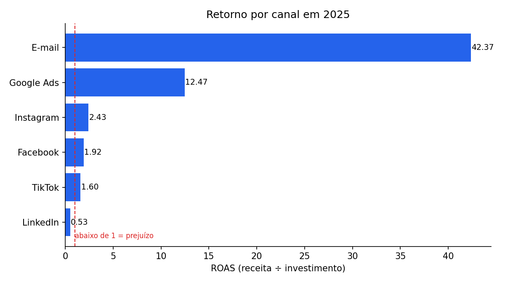
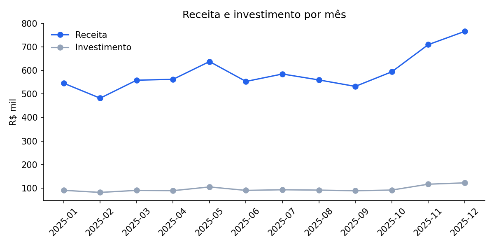

# Análise de campanhas de marketing com Python

**Pergunta:** de seis canais de mídia, qual traz mais retorno para cada real investido?

Projeto de nível iniciante, com um único script comentado, feito para ser lido, rodado e modificado.

## Resultado



| Canal | Investimento (R$) | Receita (R$) | CTR % | CPC (R$) | CPA (R$) | ROAS |
|---|---:|---:|---:|---:|---:|---:|
| E-mail | 31.396 | 1.330.235 | 3,00 | 0,20 | 4,50 | 42,37 |
| Google Ads | 354.035 | 4.413.737 | 4,52 | 0,84 | 16,82 | 12,47 |
| Instagram | 274.971 | 667.836 | 1,40 | 1,56 | 74,30 | 2,43 |
| Facebook | 194.744 | 374.706 | 1,11 | 1,63 | 88,64 | 1,92 |
| TikTok | 137.251 | 219.626 | 1,60 | 0,75 | 82,04 | 1,60 |
| LinkedIn | 156.002 | 82.928 | 0,79 | 12,05 | 787,89 | 0,53 |

O que os números mostram:

- **E-mail tem o maior ROAS**, mas com o menor investimento. Retorno alto em volume pequeno não garante o mesmo resultado se o orçamento crescer.
- **Google Ads é quem sustenta a receita**: maior volume e segundo melhor retorno.
- **LinkedIn dá prejuízo** neste cenário (ROAS abaixo de 1): o clique custa caro e converte pouco.



> Os dados são fictícios, gerados para estudo. As conclusões valem como exercício de análise e não como referência de mercado.

## As métricas

| Métrica | Conta | Responde |
|---|---|---|
| CTR | cliques ÷ impressões | De quem viu o anúncio, quantos clicaram? |
| CPC | investimento ÷ cliques | Quanto custa cada clique? |
| CPA | investimento ÷ conversões | Quanto custa cada venda? |
| ROAS | receita ÷ investimento | Quanto volta para cada R$ 1 investido? |

**Erro comum:** calcular a taxa de cada dia e depois tirar a média. O certo é somar tudo primeiro e dividir depois, como o script faz.

## Como rodar

```bash
git clone https://github.com/iasenai1111-ux/python-analise-campanhas.git
cd python-analise-campanhas
pip install -r requirements.txt
python analise.py
```

A tabela aparece no terminal e os gráficos são salvos na pasta `resultados/`.

## Faça a sua versão

Ideias para transformar este projeto em um item do seu portfólio:

1. Analise por mês: o melhor canal é sempre o mesmo?
2. Simule: se o orçamento do LinkedIn fosse para o Instagram, o que mudaria?
3. Refaça a análise no Power BI e compare o trabalho.
4. Troque o dataset por dados reais de uma página ou loja que você conheça.

Dataset: [`datasets-pratica`](https://github.com/iasenai1111-ux/datasets-pratica).
